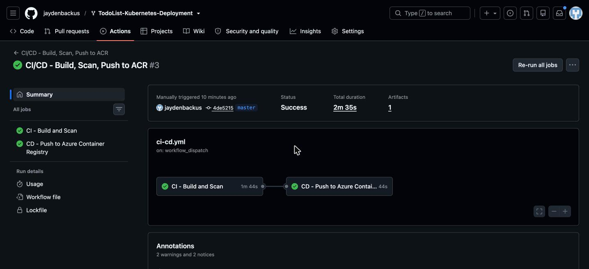
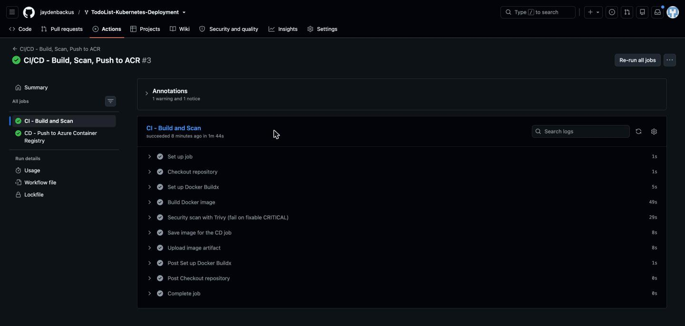
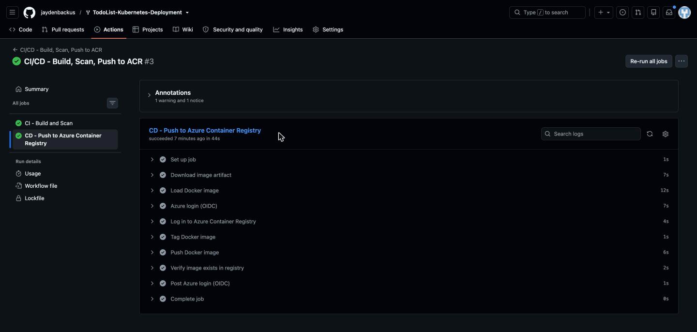
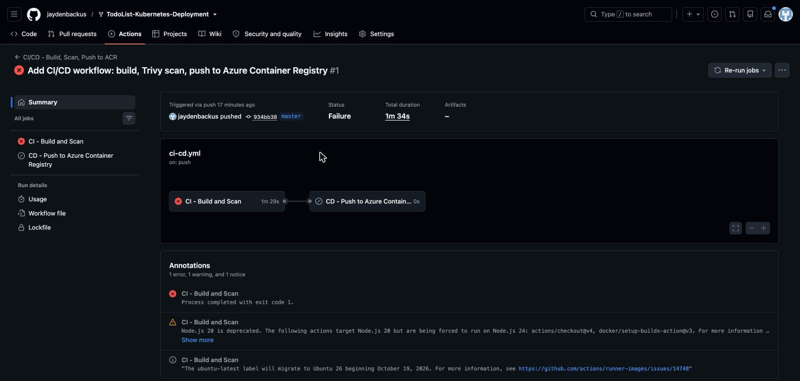
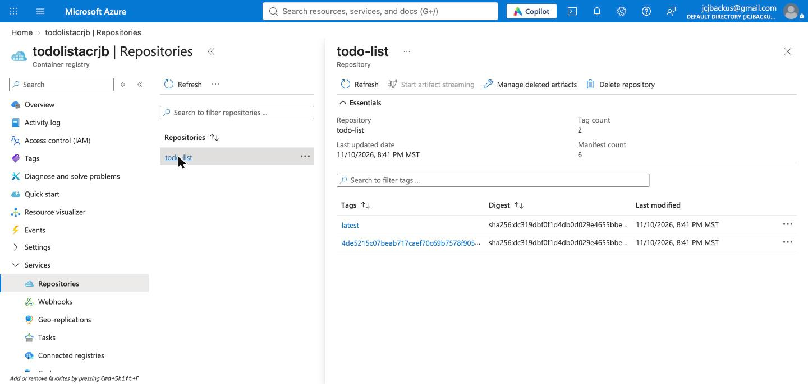
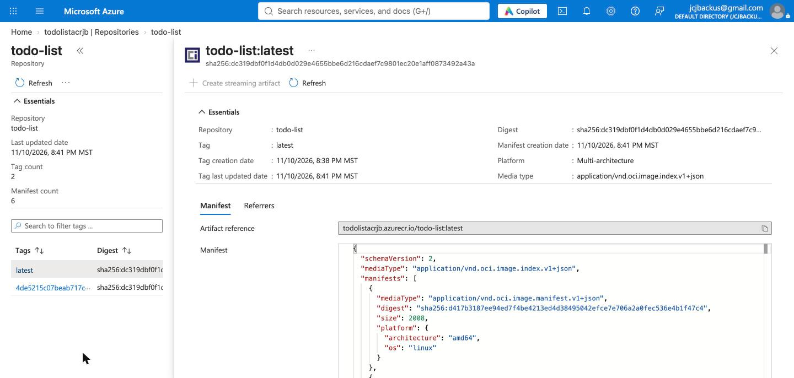

# CI/CD Pipeline: Build, Scan, and Publish to Azure Container Registry

**Student:** Jayden Backus
**Workflow:** [`.github/workflows/ci-cd.yml`](.github/workflows/ci-cd.yml)
**Successful run:** [Run #3](https://github.com/jaydenbackus/TodoList-Kubernetes-Deployment/actions/runs/42954108889)
**Registry image:** `todolistacrjb.azurecr.io/todo-list:latest`

## Pipeline design

One workflow holds two jobs. The CD job declares `needs: ci`, so it starts only after CI succeeds, and it runs only on the `master` branch.

```
Push to master
    ↓
CI job:  Checkout → Build image → Trivy scan (fail on fixable CRITICAL) → Save image as artifact
    ↓  (only if CI passes)
CD job:  Load image → Azure login (OIDC) → ACR login → Tag → Push → Verify tags in registry
    ↓
Azure Container Registry (todolistacrjb)
```

CD pushes the same image that CI built and scanned. CI saves the image as a workflow artifact, and CD loads it. Nothing is rebuilt after the scan.

**Authentication.** GitHub Actions signs in to Azure with OpenID Connect (OIDC). An Entra ID app registration trusts tokens from this repository's `master` branch only. It holds the `AcrPush` role on this one registry and nothing else. No password or key exists anywhere. GitHub stores only the client, tenant, and subscription IDs as secrets, and the registry name as a variable.

**Tags.** Each image gets two tags: `latest` and the full commit SHA. The SHA tag ties every image to the exact code that produced it.

## Screenshot 1: GitHub Actions

### Successful run summary

CI passed, then CD ran.



### CI job: checkout, build, security scan



### CD job: Azure login, tag, push, verify



### The gate in action: the first run failed CI

The first run found eight fixable CRITICAL vulnerabilities in npm packages that other packages depend on (`form-data`, `pbkdf2`, `sha.js`, `shell-quote`, and others). Trivy failed the CI job, and GitHub skipped the CD job, so no vulnerable image reached the registry. I updated those packages in `package-lock.json`, and the next run passed.



## Screenshot 2: Container registry

The `todo-list` repository in `todolistacrjb`, with both tags pointing to the same digest.



## Screenshot 3: Image details

Repository, tag, digest, and the full artifact reference `todolistacrjb.azurecr.io/todo-list:latest`.



## Reflection

**1. What is the difference between CI and CD?**
Continuous integration tests every change. Each push is built, tested, and scanned automatically, so problems appear quickly. Continuous delivery takes a build that passed and moves it toward release. Here, CD publishes the image to a registry. CI asks whether the change is good; CD delivers it once the answer is yes.

**2. Why build and scan the image before pushing it?**
Deployments pull images from the registry and trust what they find there. If unscanned images could reach it, a vulnerable image could be deployed before anyone noticed. Scanning first means only images that met the security bar are ever published. My first run shows this: Trivy found critical vulnerabilities, and the image never left the runner.

**3. What would happen if the CI build failed?**
The workflow would stop. The CD job depends on CI, so GitHub marks it as skipped, and nothing is pushed. The registry keeps the last good image. The first run above failed in exactly this way.

**4. Why store Docker images in a container registry?**
A registry stores versioned images in one place, where any authorized system can pull them. Servers and clusters don't need the source code or a build toolchain; they pull a finished image. Tags such as the commit SHA show exactly which code is running, and an older tag makes rollback easy. Access control limits who can push and who can pull.

**5. What else is needed to deploy this image to Kubernetes?**
Two things. First, the cluster needs permission to pull from the registry. On AKS, you attach the registry to the cluster or grant the cluster's identity the `AcrPull` role. Second, you need a Kubernetes Deployment manifest whose container image is `todolistacrjb.azurecr.io/todo-list:<tag>`, plus a Service to expose it. You would then add a deploy job after CD that runs `kubectl apply` or `kubectl set image` with the new tag.
